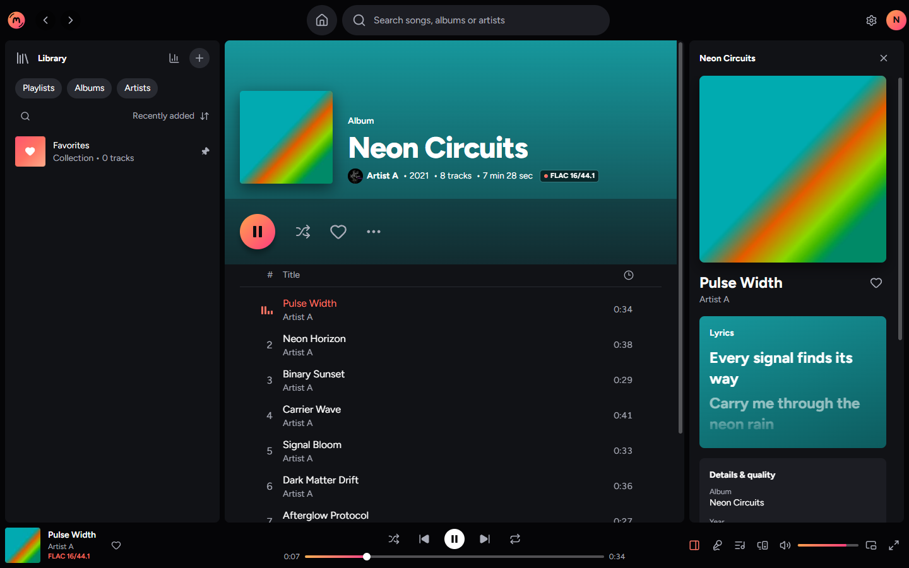
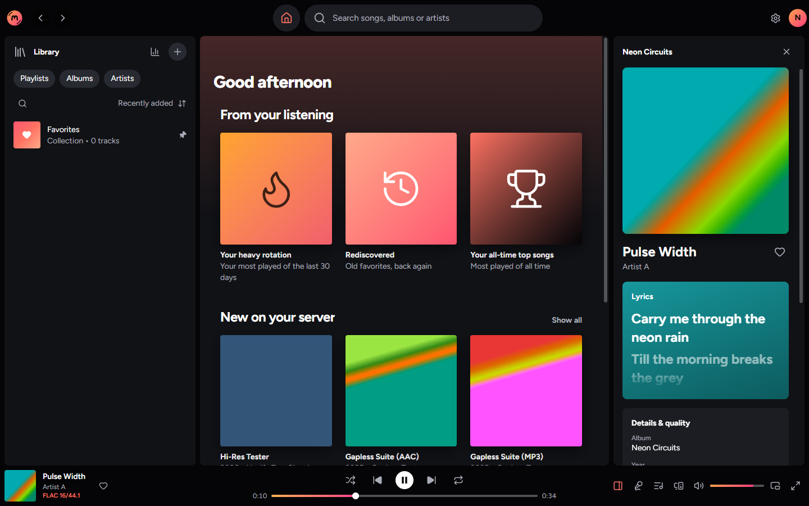
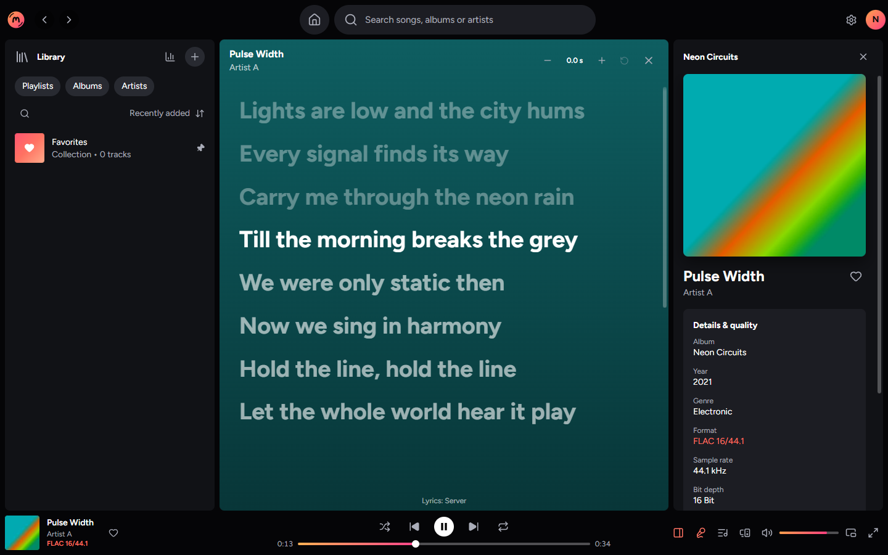
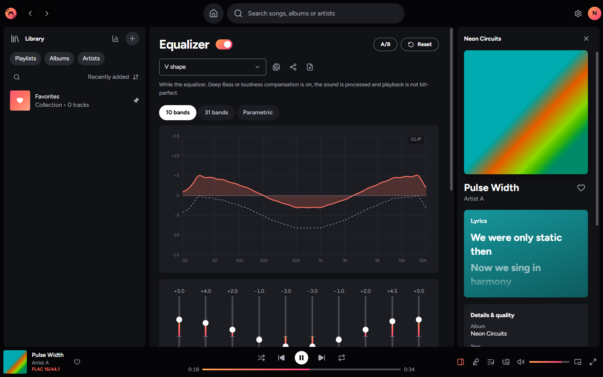
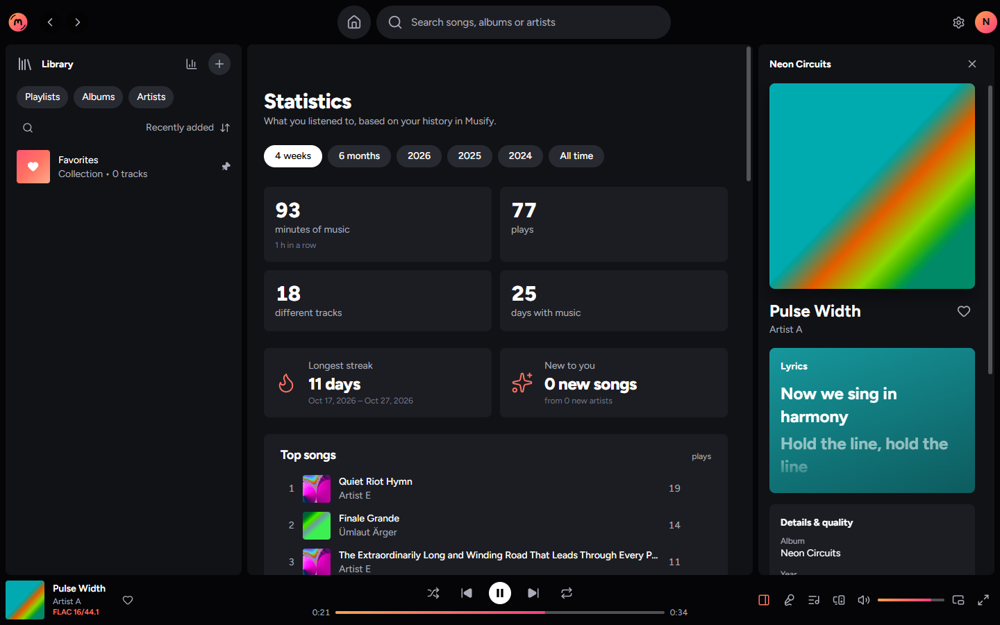

<p align="center"></p>

<h1 align="center">Musify</h1>

<p align="center">A fast desktop music player for your own <b>Navidrome</b>, <b>Subsonic/OpenSubsonic</b> and <b>Jellyfin</b> server.</p>

<p align="center"></p>

## What it does

- **Sound first**: native audio engine with 64-bit processing, hi-res up to 32 bit / 384 kHz, gapless playback, crossfade, volume normalization, true-peak limiter and an exclusive mode that plays every track at its own sample rate.
- **Equalizer**: 10 and 31 bands or parametric, presets, AutoEQ import, Deep Bass.
- **Lyrics** that scroll with the music, from your server, `.lrc` files or LRCLIB.
- **Downloads** for offline listening, playlists with drag and drop, queue, Shuffle+, continue where you stopped (also from another device).
- **Statistics**, a listening calendar, automatic playlists and a yearly Recap.
- **Your look**: 24 accent colors and gradients, miniplayer, full-screen player, 27 languages.
- **Desktop**: media keys, tray, start with Windows, Discord status.

## Screenshots

|                                              |                                           |
| :------------------------------------------: | :---------------------------------------: |
|            |     |
|        Home with automatic playlists         |     Lyrics that scroll with the music     |
|  |  |
|          Equalizer with live curve           |         Your listening statistics         |

## Install

1. Download `Musify_<version>_x64-setup.exe` from [Releases](https://github.com/Bulma1337/musify/releases) and run it. No admin rights needed.
2. Start Musify and enter your server address, user name and password (or API key).

Musify updates itself. The installer is not code-signed yet, so Windows SmartScreen may ask once: "More info" → "Run anyway".

## Build it yourself

You need [Node.js 24+](https://nodejs.org), [Rust](https://rustup.rs) and the [Tauri prerequisites](https://v2.tauri.app/start/prerequisites/) (on Windows: Visual Studio Build Tools with C++ and CMake).

```bash
git clone https://github.com/Bulma1337/musify.git
cd musify
npm install
npm run tauri dev      # run it
npm run tauri build    # installer in src-tauri/target/release/bundle
```

Before a pull request: `npm run typecheck`, `npm run lint`, `npm test`, and in `src-tauri/` `cargo clippy --all-targets -- -D warnings` and `cargo test`. Changes to the sound path need a measurement test.

## License

Musify is free under the [Musify License](LICENSE): use it privately and commercially, change it as you like, and share the original or your changed version (for example on GitHub), but only free of charge and under the same license. Nobody may sell it, neither the original nor a changed version. A changed version has to say that it is not the official Musify. Pull requests are welcome (see section 3 of the license). Third-party components keep their own licenses.
